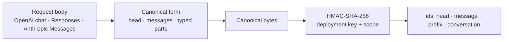

# kvsig

**A specification and reference library for keyed, content-derived ids of LLM chat conversations, so a gateway or router can tell which conversation a stateless request belongs to.**

[](LICENSE)
[](LICENSE-SPEC)
[](SPEC.md#versioning-and-compatibility)
[](https://pypi.org/project/kvsig/)



**[Read the draft specification](SPEC.md).** The reference library is on PyPI:

```bash
pip install kvsig
```

```python
from kvsig import Key, canonicalize, ids

key = Key.generate(epoch=1)  # one per deployment; every id depends on it
canon = canonicalize(request_body, "anthropic.messages")  # None means "no ids"
if canon is not None:
    i = ids(canon, key)
    i.conv  # conversation id: stable across turns, reminders, dates and tool changes
    i.nodes[-1]  # id of the whole prefix, like a git commit
    i.sys, i.tools  # the two halves of the head: which one changed?
```

More in the [Python package README](python/README.md).

## The problem

A coding agent sends 200 KB of conversation with every turn, and most clients
send no conversation id. The gateway in front of your inference servers sees a
stream of unrelated requests. It cannot keep a conversation on the replica that
already holds its prompt cache, it cannot group requests into sessions in logs
or traces, and it cannot tell a compaction or a forked subagent from a new user.

Every project solves this its own way today. Session affinity runs on
project-specific headers (`x-session-id`, `x-session-token`,
`x-litellm-session-id`, and others). KV-aware routing hashes token blocks, which
are engine- and tokenizer-specific. Nothing in between says how to derive "which
conversation is this" from the request content itself, in a way two independent
components agree on.

kvsig defines that:

- a **canonical form** for a chat request that is the same whichever API
  dialect carried it;
- an **exact** and a **loose** profile (the loose one ignores harness noise
  such as reminders, dates, reasoning and whitespace);
- **keyed ids** (HMAC under a per-deployment key) for the head (system prompt
  and tools), each message, each prefix (chained, like git commits) and the
  conversation;
- **test vectors**, so every implementation can prove it produces the same
  bytes and ids.

## What it is, and what it is not

- It is message-level identity. It is **not** token-block hashing for KV
  caches; that stays with the engines (vLLM, llm-d, Dynamo). kvsig tells you
  *which conversation*; block hashes tell you *which blocks*.
- Ids are keyed per deployment. Without the key they reveal nothing and cannot
  be correlated across deployments. A holder of the key can confirm a guessed
  message, so treat the key and its ids as content-adjacent. The spec's
  privacy section states this up front.
- Derived ids are **not** for OpenTelemetry's `gen_ai.conversation.id`, which
  the GenAI conventions reserve for real ids
  ([semantic-conventions-genai #219](https://github.com/open-telemetry/semantic-conventions-genai/pull/219)).

## Status

Draft 0.1, reference library 0.1.0. What 0.1 promises:

- **Ids are stable.** Under the spec label `kvsig/1` and the default loose
  profile `loose/1`, the canonical bytes and ids pinned by the
  [`vectors/v1`](vectors/) test vectors (revision 0.1) do not change in any
  later release. A change to them ships as a new label or profile version.
- **`loose/2` is experimental.** It ships as `LOOSE_V2`, has no vectors yet, and
  may change until [decision 0005](docs/decisions/0005-developer-role-in-the-loose-form.md)
  is accepted.
- **The text is incomplete.** Until each section of [SPEC.md](SPEC.md) is
  written, the [decisions](docs/decisions/) and the vectors are the rules.

The full policy: [Versioning and compatibility](SPEC.md#versioning-and-compatibility).
Version 1.0 freezes the text of spec v1 after a period of real traffic and an
outside review.

The scheme comes from the conversation-identity layer of
[LM Warden](https://github.com/Podwarden/lm-warden), where it routes agent
sessions to the replica holding their cache. This repository is its
vendor-neutral home.

## Repository layout

| Path | Contents |
|---|---|
| [`SPEC.md`](SPEC.md) | The normative specification (draft) |
| [`vectors/`](vectors/) | Test vectors, one directory per spec version |
| [`python/`](python/) | Reference implementation (pure Python), released on PyPI as `kvsig` |
| [`rust/`](rust/) | Rust core, with Python bindings through PyO3 (not released yet) |
| [`conformance/`](conformance/) | Runner that checks any implementation against the vectors |
| [`docs/reading-the-ids.md`](docs/reading-the-ids.md) | What each id identifies, and how to tell what changed between two requests |
| [`docs/decisions/`](docs/decisions/) | Recorded design decisions |
| [`CHANGELOG.md`](CHANGELOG.md), [`RELEASING.md`](RELEASING.md) | Release history, and how a release is published |

## Contributing

Issues and pull requests are welcome, including on the spec text. Normative
changes have a 14-day comment period. Commits need a DCO sign-off; see
[CONTRIBUTING.md](CONTRIBUTING.md) and [GOVERNANCE.md](GOVERNANCE.md).

## Security

Report vulnerabilities privately; see [SECURITY.md](SECURITY.md).

## Licence

Code is licensed under the [Apache License 2.0](LICENSE). The specification
text (`SPEC.md` and `docs/`) is licensed under
[Creative Commons Attribution 4.0](LICENSE-SPEC). Test vectors are under
Apache-2.0 with the code. "PodWarden" and "LM Warden" are trademarks of their
owners; kvsig itself is not a registered mark.
